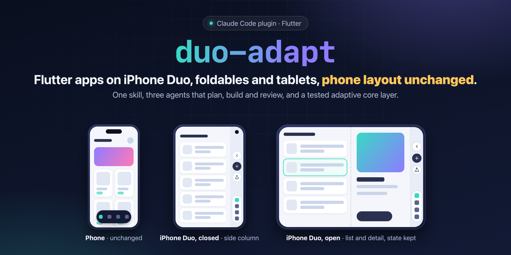
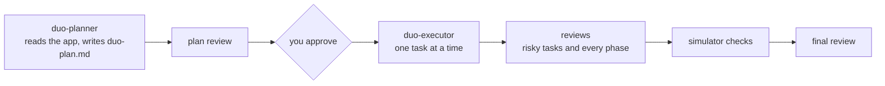

<p align="center">
  
</p>

# duo-adapt

**Adapt any Flutter app for iPhone Duo, foldables and tablets, without changing a pixel of the phone layout.**

duo-adapt is a [Claude Code](https://claude.com/claude-code) plugin. It brings one skill that orchestrates three agents (planner, executor, reviewer), a shared plan with the hard decisions already made, and a tested adaptive core layer that gets copied into your app.

## Why

iPhone Duo puts the system bars in an 84 pt column on the side of the screen: on the outer display, and on the inner display in landscape. An app built for portrait phones has a rough time there:

- content slides under the side column;
- `flutter_screenutil` with a phone design size scales the whole UI about 2x on the inner display;
- folding or unfolding rebuilds screens, so the text you typed, the selected item and the scroll position are gone;
- Flutter 3.47 does not report the fold on iOS yet (`MediaQuery.displayFeatures` is empty).

Tablets, Android foldables and phones in landscape share most of these problems. duo-adapt fixes them the same way in every app.

## What it does

- **Two layers.** An adaptive layer for every device (breakpoints, navigation, list/detail, readable widths, grids, safe area, state), and a fold layer that only runs while a half-open fold is reported.
- **Apple-style navigation on iPhone Duo.** Back, page actions and tabs move into the side column, inside the system's own 84 pt bar. Everywhere else you get a bottom bar or a rail. The side column is detected from the safe area only, never from the device model.
- **List/detail that survives folding.** The selection lives in your state management, both panes keep their state under GlobalKeys, and grid columns stay even in Book posture.
- **The phone stays exactly as it is.** Every UI task pins phone values in a test before the code changes, and the reviewer checks them against `HEAD`.
- **iOS groundwork.** UIScene migration, all orientations, iPad support (only with your approval), and a pinned bridge package that reports the fold on iOS.

## How it works



- **duo-planner** profiles the project (state management, routing, ScreenUtil, iOS setup, plugins, payments, tests, the project's own checks) and turns the shared plan into small tasks that each stand on their own.
- **duo-executor** carries out one task at a time. It pins the phone values first, shows that every new test fails on the old code, runs the project's checks, and records the result in the plan.
- **duo-reviewer** is read-only. It reviews the plan before you see it, every high-risk task as soon as it is done, every phase (two reviewers in parallel, one on the rules and one on the tests) and the final result.
- The main session orchestrates, drives the iOS simulator, and brings you every decision the plan does not make.

Safety rails: it never commits or pushes, new packages, iPad support and payment changes wait for your approval, and only one agent writes at a time.

## Install

As a Claude Code plugin:

```text
/plugin marketplace add islam-diab/duo-adapt
/plugin install duo-adapt@duo-adapt
```

Or by hand:

```bash
git clone https://github.com/islam-diab/duo-adapt.git
cp -R duo-adapt/skills/duo-adapt ~/.claude/skills/
cp duo-adapt/agents/*.md ~/.claude/agents/
```

## Use

Open Claude Code in your Flutter project and ask:

> Adapt this app for iPhone Duo, foldables and tablets.

You can also run the skill directly: `/duo-adapt` (listed as `duo-adapt:duo-adapt` when installed as a plugin). Progress is kept in `duo-plan.md` at the project root, so running it again later continues where it stopped.

## Requirements

- Claude Code. The three agents run on Opus.
- Flutter 3.41 or newer (3.47.5 is the version that builds with Xcode 27.1) and Dart 3.0 or newer.
- A git repository, because the reviews read `git diff`.
- For the iOS checks: Xcode 27.1 with the iPhone Duo simulator.

## What's inside

```text
.claude-plugin/          plugin and marketplace manifests
agents/                  duo-planner, duo-executor, duo-reviewer
skills/duo-adapt/
  SKILL.md               the orchestration
  references/plan.md     the shared plan: decisions, measured facts, phases, rules
  templates/             core layer (lib/core/responsive), its tests (test/duo), iOS UIScene files, debug probe page
  scripts/               test_templates.sh, check_sync.sh
```

The core layer contains `AdaptiveShell` (bottom bar, rail or side column), `AdaptivePage` and `PageAction`, `ListDetailLayout`, `AdaptiveSliverGrid` and `AdaptiveRowGrid`, `readableGutter`, `KeptAlive`, `SideInsetsFrame`, the fold layer (`activeFold`, `FoldLayoutBuilder`, `FoldAwareSplit`) and `CappedScreenUtilInit`. Its 57 tests run on a matrix of 15 devices: phones, tablets, an Android foldable and every iPhone Duo pose.

## Status

Built in October and November 2026, right after iPhone Duo came out, and already used on two real apps. The values come from a community design kit and from measurements on the Xcode 27.1 simulator. A few checks are still open (real devices, Split View, the outer display in landscape); the shared plan keeps the list. Reports and measurements are welcome.

## Language

Everything in this repository is in English. Claude talks to you in the language you write in, and writes each project's `duo-plan.md` in that language.

## Maintaining the templates

```bash
skills/duo-adapt/scripts/test_templates.sh          # strict analyze + tests, in a throwaway Flutter project
skills/duo-adapt/scripts/check_sync.sh <project>    # compare a project's core layer with the templates
```

## Credits

- iPhone Duo values: *iPhone Duo Adaptive Design Starter Kit* by Noah Elhadedy (community, v1.0), checked against simulator measurements.
- The fold on iOS: the [`foldable`](https://pub.dev/packages/foldable) package.

## License

[MIT](LICENSE)
